# Guía de uso de AsistIA (versión 4, textos alineados con la propuesta v5.1)

Para alguien que nunca vio el sistema. Dirección pública: **https://ods3-hackathon.vercel.app** (use siempre este dominio).

> Demostración. Pacientes ficticios. Citas y modelo basados en datos abiertos reales del Hospital María Auxiliadora (2023).

## 1. Qué hace, en una frase por pantalla

| Pantalla | Quién | Para qué |
|---|---|---|
| `/` | Todos | Presentación del problema y de la propuesta |
| `/pedir-cita` | Cualquier persona (el jurado, por QR) | Pedir una cita por **chat**, por **llamada en el navegador** o con el **formulario**. Sin instalar nada y sin dar su número |
| `/acceso` | Equipo | PIN y elección de rol: **Admisión**, **Regulador** o **Call center** |
| `/panel` | Admisión | Pestañas **Citas**, **Lista de espera**, **Por reasignar**, **Por validar** y enlace al **Tablero** |
| `/regulador` | Regulador (o Admisión) | Asignar P1–P4 **sin ver** nombre, documento, seguro ni distrito |
| `/callcenter` | Call center (o Admisión) | Las pocas tareas que necesitan a una persona, con su guion |
| `/tablero` | Admisión | Indicadores de la propuesta, equidad y escenario `r ≈ s + c·f` |
| `/demo` | Operador (Admisión) | Reloj de la demo, códigos QR, **En vivo**, parámetros y **Reiniciar demo** |
| `/t/<nombre>` | Integrantes con celular | Teléfonos simulados de Rosa, Valeria, Carmen, Julio, Ana y Luis |

## 2. Entrar y cambiar de rol

1. Abra `/acceso`, elija el rol y escriba el PIN 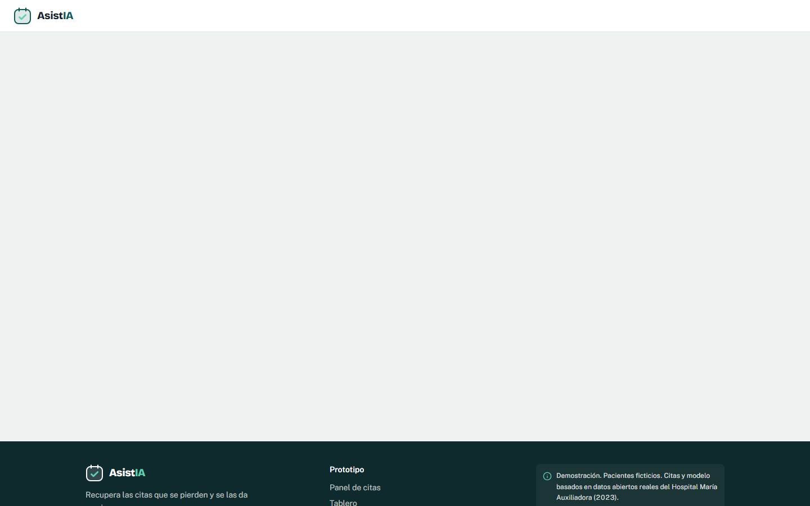
2. Para cambiar de rol sin volver a escribir el PIN: botón con el nombre del rol, arriba a la derecha.
3. Cada rol solo ve lo suyo. El Regulador no puede abrir el panel de Admisión: el servidor responde 403.

## 3. Cada pantalla

### Citas (Admisión)

Las 1,473 citas reales del jueves 19 de octubre de 2023 («en 3 días»), con su riesgo de inasistencia explicado. Botones:

- **Enviar recordatorios (72 h):** mensaje a todas las citas con mensajería (el 69 %; el resto recibe llamada).
- **Llamadas 48 h:** el asistente llama a quienes no usan mensajería y a quienes no respondieron del 10 % de mayor riesgo. También ocurre solo al cerrar el plazo de respuesta.
- **Último recordatorio 24 h.**
- Nadie pierde su cita por no responder: «Sin respuesta» significa que la cita se mantiene.

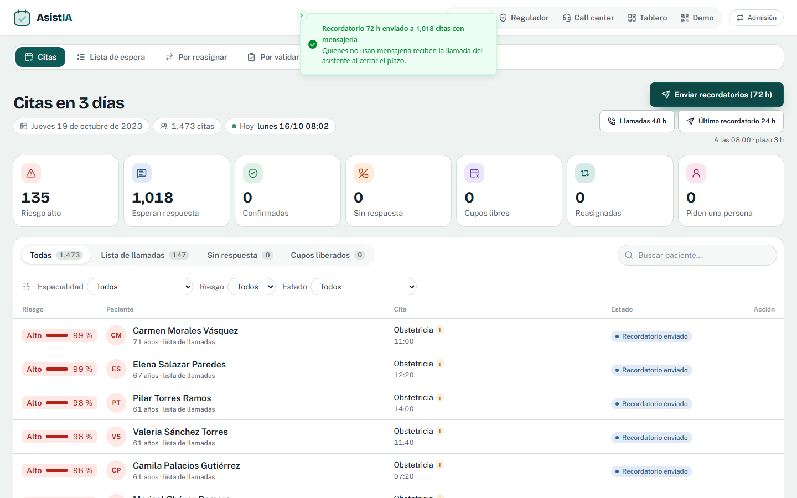

### Lista de espera (Admisión)

Toda la demanda, aunque no haya cupo. Orden (propuesta v5.1): primero la categoría clínica y, dentro de ella, la fracción del plazo ya consumida desde el primer intento, sin bonos; con la razón en una línea (por ejemplo, «P2 · 69 % de su plazo»). Pendiente en el código: la pantalla todavía suma los bonos de la v4 por primera consulta y atención preferente.

- **Registrar solicitud:** formulario de ventanilla (nombre ficticio, edad y especialidad bastan; el documento puede ser «sin documento»). Entra como *pendiente de regulación*.
- **Ojo (ver):** fechas acumuladas (indicación, recepción, regulación, fecha límite, ofertas, confirmación) y **Ver como FHIR**.
- **Retirar:** solo con un motivo (atendido en otro lugar, ya no lo necesita, duplicado u otro con texto). «No respondió» no existe.

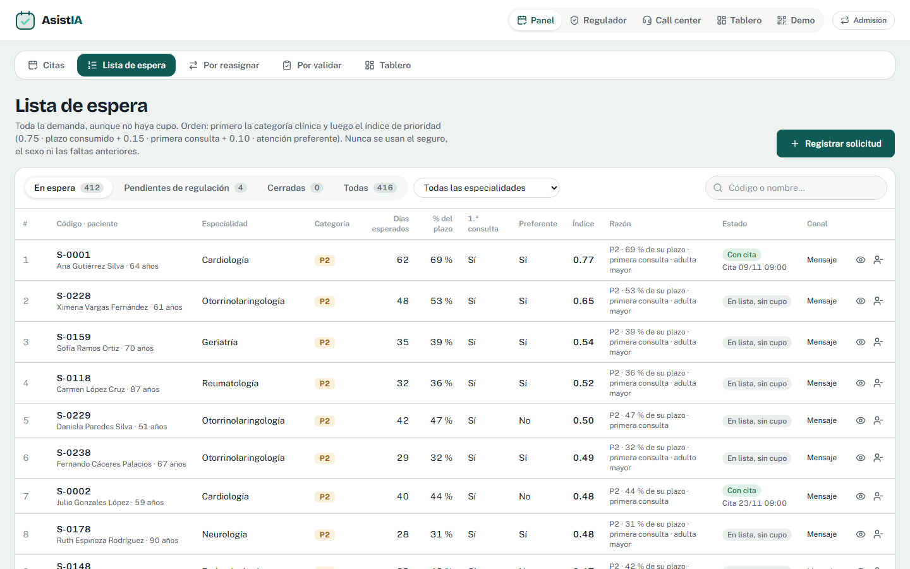 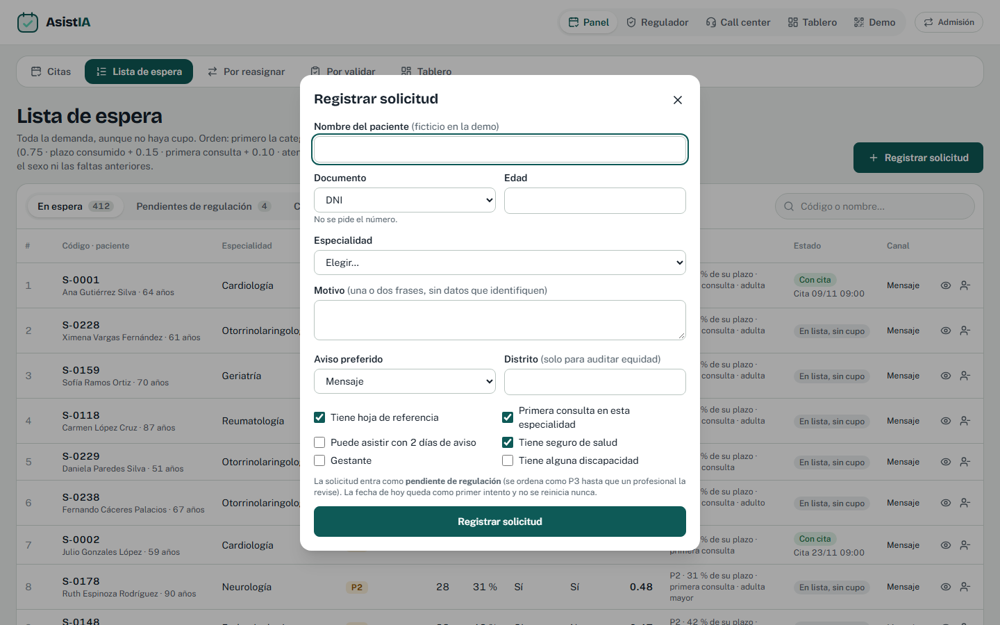

### Regulador

Tarjetas de las solicitudes pendientes con el tiempo que llevan frente al plazo de 72 h. Botones **P1 a P4**, **Pedir más información** (la fecha no cambia) y **Signos de alarma: derivar a emergencia** (avisa al call center y al paciente).

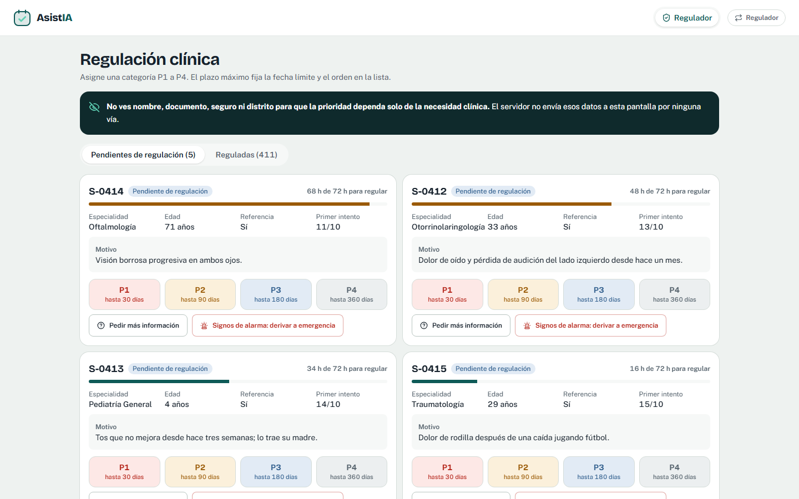

### Por reasignar (Admisión)

Cada cupo libre muestra su **zona** (cercana 2–3 días: P1–P2 y poco aviso; media 4–14: P2–P3; lejana: P3–P4), si es **protegido**, los candidatos propuestos con su prioridad y razón, **k** y la **probabilidad de llenarlo** («54 % con 4 candidatos, todos los de la zona»).

1. **Aprobar y enviar oferta a k:** sin su aprobación no sale nada; queda registrado quién aprobó.
2. Las respuestas aparecen en vivo. **Acepta / No** al lado de cada candidato es el botón **Usar simulado** (plan B si un celular falla).
3. **Cerrar oferta y asignar:** con la regla «mayor prioridad al cierre de la ventana», gana el de mayor prioridad entre quienes aceptaron, aunque otro haya respondido primero. Se ve el mensaje «Asignado a Ana G. (P2, 69 % de su plazo) aunque Julio respondió primero (P2, 44 %)» (hoy, con los bonos de la v4, todavía dice 0.77 y 0.48). La v5.1 compara esta regla con «primero que acepta».
4. Si el ganador tenía una cita más lejana, al validar se libera y aparece aquí como **efecto dominó**.

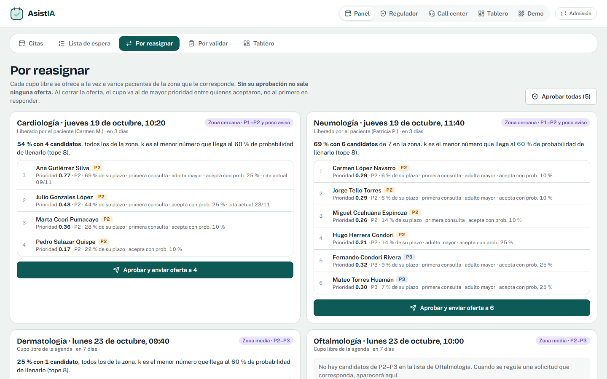 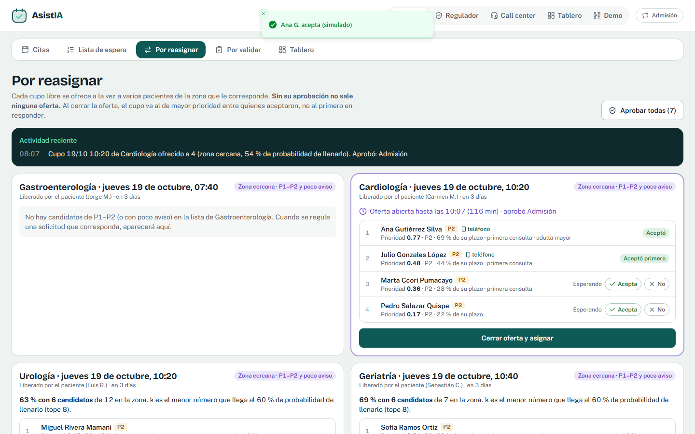 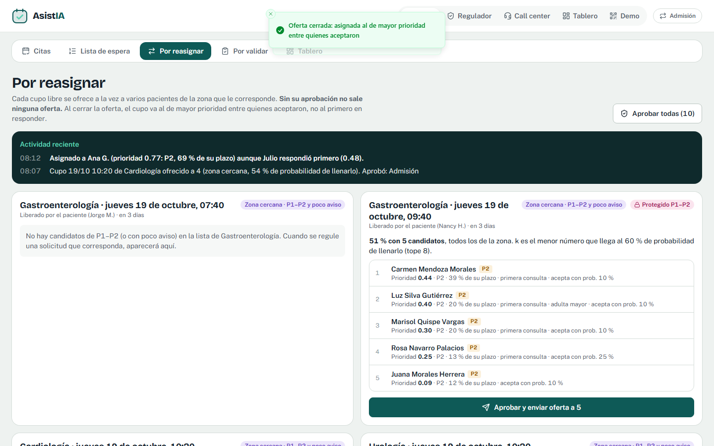 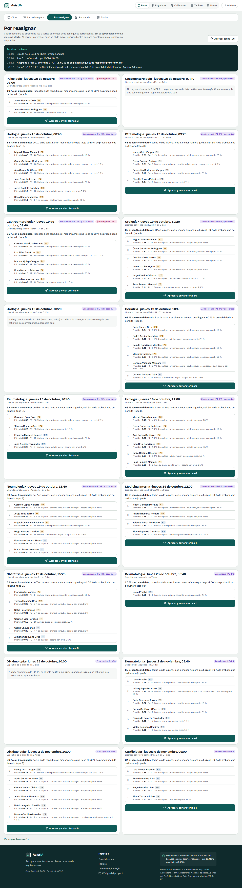

### Por validar (Admisión)

Asignaciones que esperan la confirmación del paciente (por mensaje, chat o el agente de voz) y reprogramaciones elegidas por los pacientes. Botones: **Llamar con el agente**, **Validé por teléfono**, **Usar simulado: confirma**, **No puede** (pasa al siguiente que aceptó), **Revertir** (pide motivo), **Aprobar / Rechazar** reprogramación.

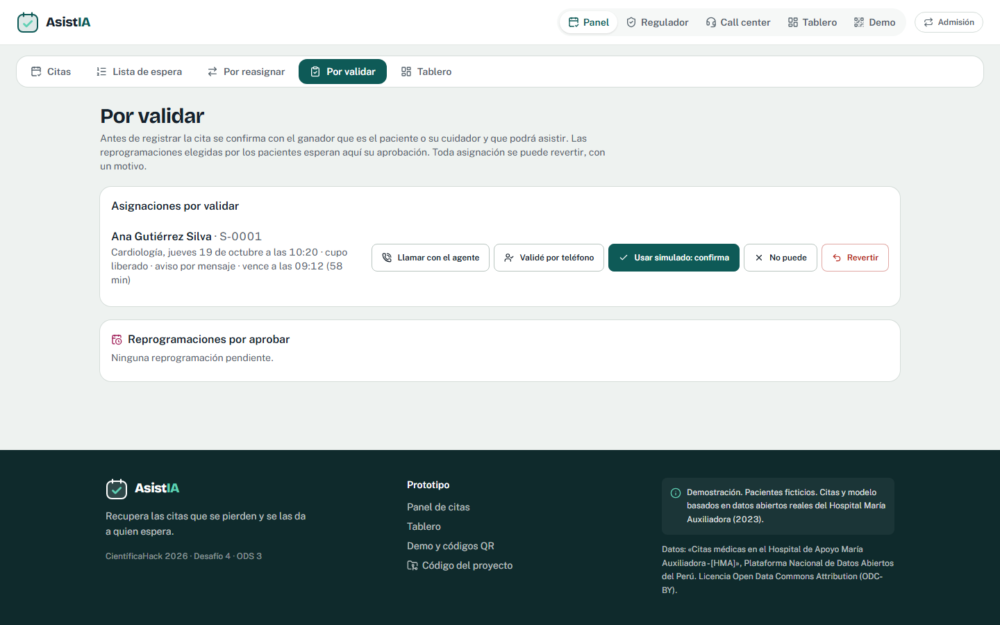

### Call center

Tareas por tipo, cada una con un guion breve, y botones de resultado: confirmó, rechazó, no contestó, pidió otra fecha. Arriba, la **carga del personal hoy**.

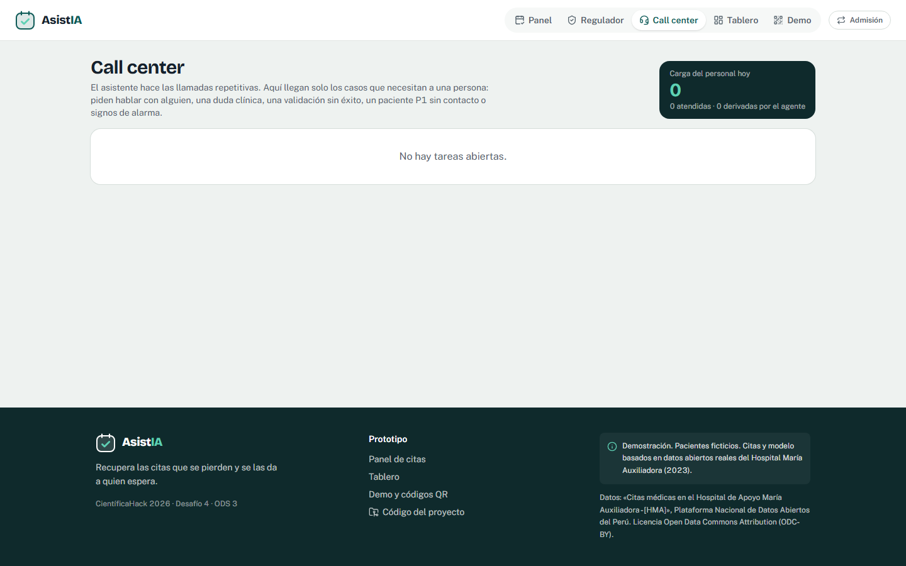

### Tablero

Personas registradas sin cupo, % con atención, mediana y percentil 90 de la espera, % fuera de plazo, cupos liberados que se llenan, ofertas, validaciones, retiros sin atención, carga del personal e inasistencia; **equidad** por categoría (60+, menores de 12, sin seguro; «Grupo pequeño» si hay menos de 5); escenario **r ≈ s + c·f** editable (supuesto) con la línea de referencia del costo (la v5.1 la fija en 5.2 %; el parámetro todavía dice 5.3 %); y **Ver qué pasó** ese día real.

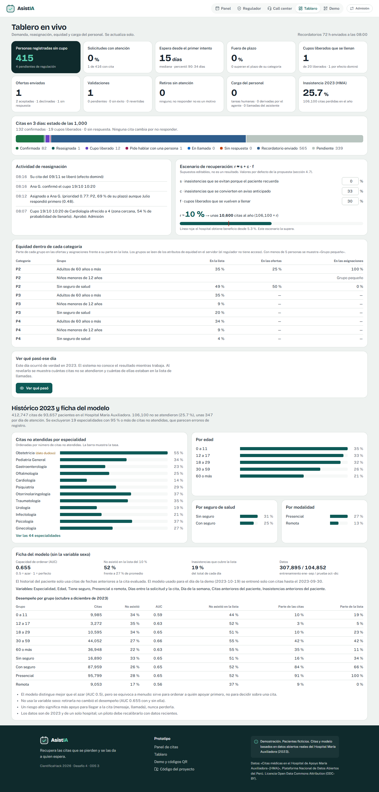

### Teléfonos simulados y `/pedir-cita`

- Teléfonos: mensajes con botones (Confirmo, No podré asistir, Reprogramar, Hablar con una persona; Acepto/No puedo; Sí, soy el paciente/cuidador). 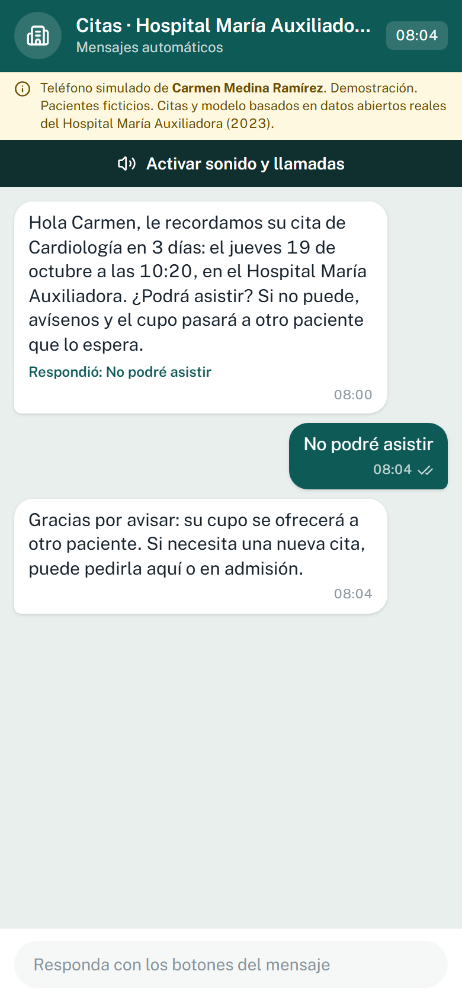 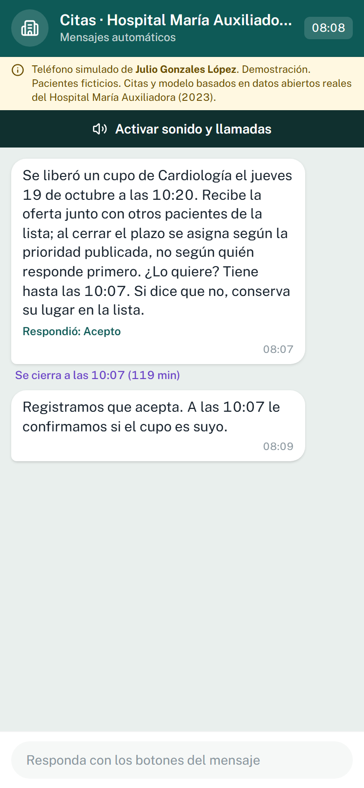
- Llamada entrante a pantalla completa con tono, dentro del navegador (no hay números reales): **Contestar** inicia la voz del agente, que se presenta como asistente automatizado del Hospital de demostración; **Rechazar** cuenta como un intento. 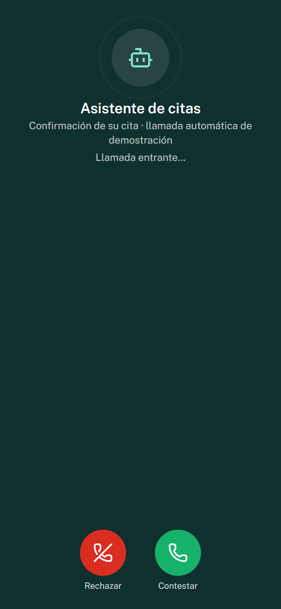
- `/pedir-cita`: tres opciones. El chat pide **ACEPTO**, recoge los datos uno por uno, pregunta por signos de alarma y entrega un código S-XXXX. «PERSONA» crea una tarea; «SALIR» o el tacho borran la conversación. 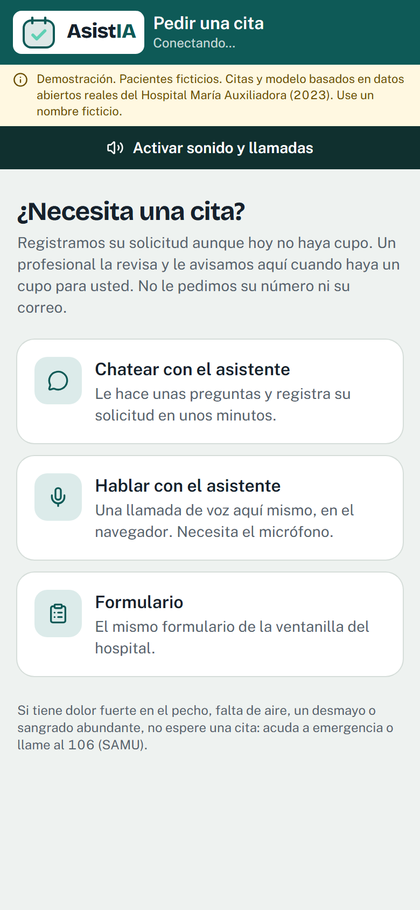 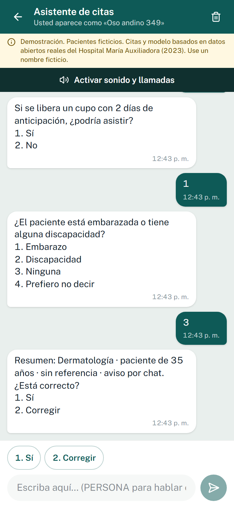 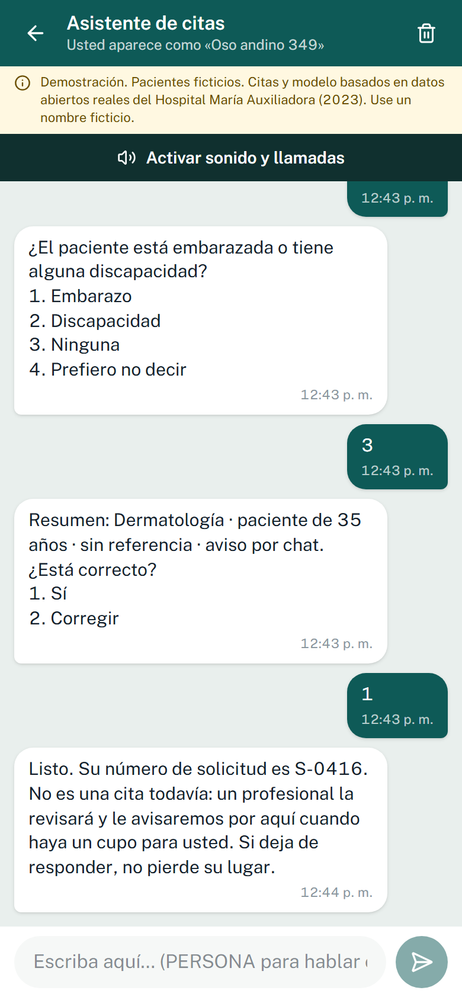

## 4. Preparar la demo (10 minutos antes)

1. En `/demo`: **Reiniciar demo** (borra todo lo hecho, incluidas las sesiones de chat; tarda 2 s).
2. Celular de un integrante: abrir `/pedir-cita` (QR de `/demo`), tocar **Activar sonido y llamadas**, **Chatear**, responder **ACEPTO**. En `/demo` → **En vivo**: vincular esa sesión a **Julio**.
3. Otro celular: abrir el teléfono de **Rosa** (QR) y tocar **Activar sonido y llamadas** (pide el micrófono). Volumen alto, sin modo silencio.
4. Opcional: teléfonos de Carmen y Ana en otros celulares o pestañas. Si no, use los botones **Usar simulado**.
5. En **En vivo**: **Probar mensaje** y **Probar llamada** en cada celular. Deben aparecer como «Conectada/Abierto» y «sonido listo».
6. Laptop del proyector: `/panel` como Admisión. Segunda pestaña: `/regulador`.

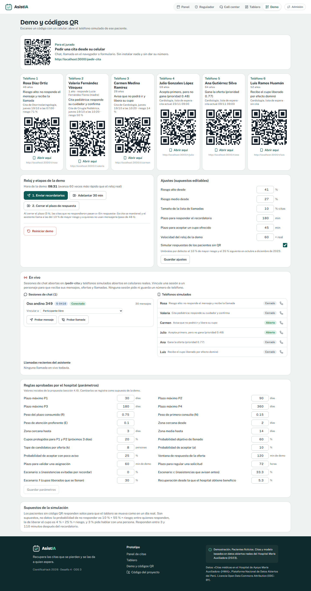

## 5. Pruebas en vivo

| Prueba | Cómo | Qué debe pasar |
|---|---|---|
| Registro por chat | `/pedir-cita` → Chatear → ACEPTO → datos ficticios | Código S-XXXX; aparece en `/regulador` sin nombre ni alias en < 2 s |
| Registro por voz | `/pedir-cita` → Hablar con el asistente | El agente pregunta lo mismo y dicta el código; también llega al chat |
| Oferta por chat | Regular la solicitud P2 o P3 (Dermatología u Oftalmología) → Por reasignar → aprobar el cupo de zona media | En el chat llega la oferta; «1» acepta; al cerrar, «SÍ» confirma |
| Llamada entrante | Rosa sin responder → `/demo` **2. Cerrar el plazo** | Suena su celular; al contestar habla el agente y usa sus herramientas (se ven en **En vivo** → Llamadas recientes) |

## 6. Si falla un canal

| Falla | Qué hacer |
|---|---|
| El chat no recibe | Recargar la página (la conversación se mantiene). Si no, usar el **Formulario** de `/pedir-cita` o registrar en ventanilla |
| Una oferta no llega a un celular | En Por reasignar, **Acepta / No** del candidato (usar simulado) |
| La validación no llega | Por validar → **Usar simulado: confirma** o **Validé por teléfono** |
| La voz de ElevenLabs no conecta (cuota, red) | La misma llamada sigue sola con el **guion fijo** con la voz del navegador. Para forzarlo desde el inicio, abra el teléfono con `?voz=guion` (por ejemplo `/t/rosa?voz=guion`) |
| Una llamada quedó colgada | En **En vivo** → **Terminar (usar simulado)** |
| Todo se desordenó | `/demo` → **Reiniciar demo** y volver a vincular las sesiones |

## 7. Cambiar un prompt o la voz y volver a sincronizar

1. Edite `voice/agents/<agente>.json` (primer mensaje y tarea) o `voice/agents/common.json` (prompt base, modelo de lenguaje, duración).
2. Para cambiar la voz: cámbiela en el agente de prueba **AsistIA prueba** de ElevenLabs (el sync la copia de ahí) o ponga otro nombre en `ELEVENLABS_VOICE_NAME` si ese agente no existe.
3. Ejecute `npm run voice:sync`. Actualiza los 4 agentes y sus herramientas sin crear duplicados, y escribe los identificadores en `voice/agents.lock.json`.
4. Si cambió el dominio, actualice `PUBLIC_BASE_URL` antes de sincronizar (las herramientas apuntan a `PUBLIC_BASE_URL/api/voice/tools/...`).

Los textos del chat están en `src/lib/bot/machine.ts` (copiados de `docs/conversaciones.md`).
